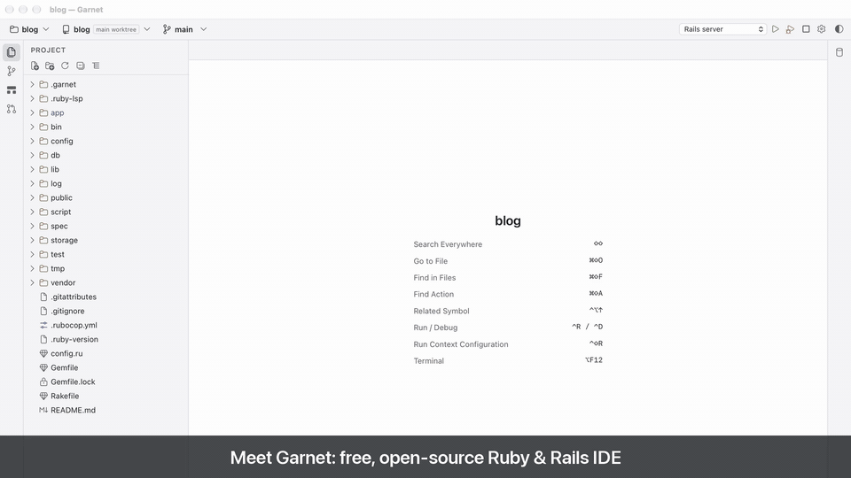
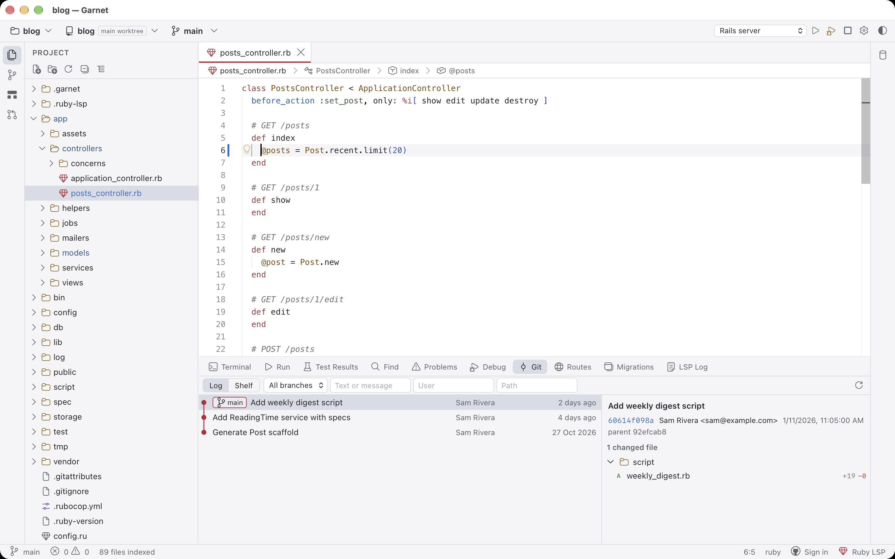
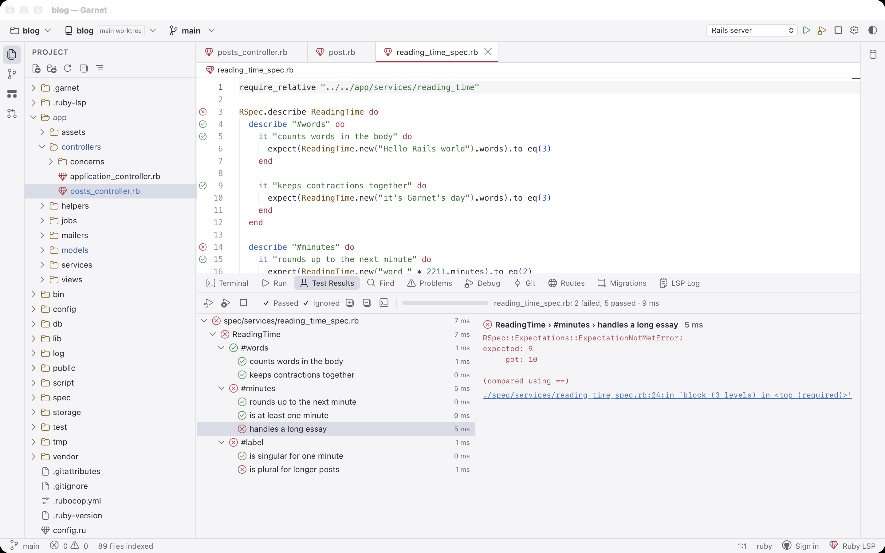
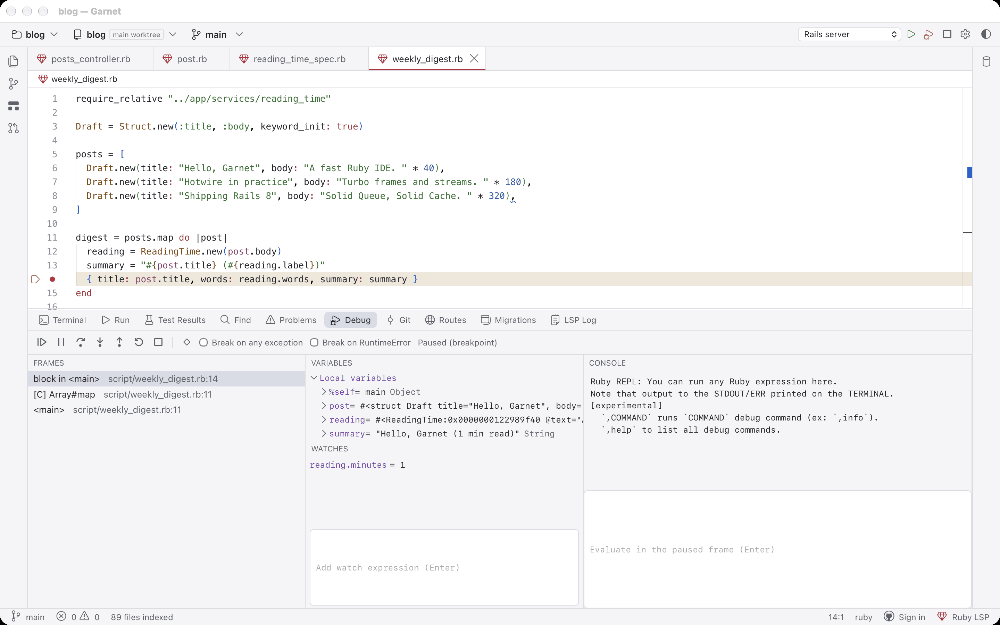
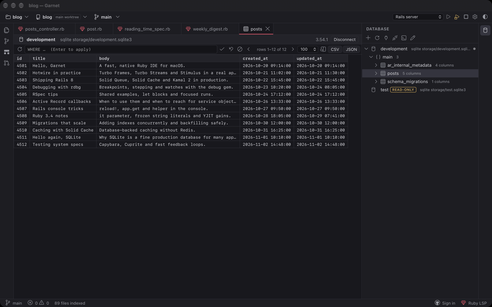

# Garnet

[](https://github.com/sachinkr7368/garnet/releases/latest)
[](LICENSE)
[](https://github.com/sachinkr7368/garnet/actions/workflows/ci.yml)


Garnet is a free, open-source Ruby and Rails IDE for macOS. It starts in about
half a second and gives you a RubyMine-style workflow: run configurations, a
real debugger, git and GitHub, Rails tools and a database console. No account,
no subscription, no telemetry.

**[Download the latest release](https://github.com/sachinkr7368/garnet/releases/latest)** (universal DMG for Apple Silicon and Intel), then see [Install](#install).

[](https://github.com/sachinkr7368/garnet/releases/download/v0.2.3/Garnet-demo.mp4)

▶ [Watch the full demo with sound](https://github.com/sachinkr7368/garnet/releases/download/v0.2.3/Garnet-demo.mp4)



<p>
  
  
  
</p>

Built with Tauri 2 (Rust) + TypeScript, Monaco for editing, xterm.js for
terminals, [ruby-lsp](https://github.com/Shopify/ruby-lsp) for Ruby
intelligence and the [debug gem](https://github.com/ruby/debug) (rdbg) for
debugging.

## Privacy

Garnet has no accounts, no subscription, no telemetry, no licence checks and
makes no network calls on its own. The only network traffic is what you
trigger: GitHub actions (sign-in, pull requests, gists, clone, fetch/pull/push)
and commands you run yourself (for example `gem install ruby-lsp`). Your GitHub
token and database passwords are stored in the macOS Keychain, never in a
settings file.

The update check is off by default. Turn it on in Settings › Updates ("Check for
new Garnet releases") and Garnet asks the GitHub Releases API at most once a
day, then shows "Garnet X is available" with a link to the release page. It
never downloads anything.

## Project trust

Opening a folder never runs code from it until you trust it. The first time
you open a folder, Garnet asks whether to trust it; your answer is kept in
Garnet's own config, keyed by canonical path, never in the repository. In safe
mode you can browse and edit files, but ruby-lsp (which loads the Gemfile),
repository run configurations, `.env` files, Rake/routes listing and restored
terminals stay off; use File: Trust Project to enable them later. Settings that
choose which programs run (`ruby.lspCommand`, `git.path`, `terminal.shell`,
`terminal.env`, `debug.rdbgPath`, `testing.*`, `rails.*`, Ruby version
manager and bundler) are global-only and are ignored in `.garnet/settings.json`.
Run configurations cannot override `PATH`, `RUBYOPT`, `BASH_ENV`, `ENV`,
`DYLD_*` or `LD_*`.

## Status

Speed budgets, measured on an Apple Silicon Mac with a 5,085-file Rails app
(warm launch; see [CONTRIBUTING.md](CONTRIBUTING.md) for the smoke harness):

| Budget | Target | Measured |
| --- | --- | --- |
| Launch to usable window | < 1 s | ~0.5 s warm (first launch after install ~1.3 s while macOS verifies the binary) |
| File tree visible after open | < 300 ms | 17–28 ms |
| Go to File index ready | < 2 s | ~40 ms |
| Go to File per keystroke | < 50 ms | ≤ 1 ms |
| Find in Files across the repo | < 500 ms | 120–135 ms |
| Typing (main-thread work per keystroke) | no lag | ~0.15 ms |
| Idle RAM, excluding ruby-lsp | < 300 MB | ~140 MB RSS (app + WebKit processes) |

Feature status compared with RubyMine. The full checklist lives in
[docs/PARITY.md](docs/PARITY.md).

| Area | Status |
| --- | --- |
| Project tree, file create/rename/delete, gitignore aware, lazy | Done |
| Editor tabs, syntax highlighting (Ruby, ERB, YAML, JS/TS, CSS, JSON, Markdown, more), dirty markers, reload on external change, auto-save | Done |
| Go to File (double Shift / ⌘⇧O), Find in Files (⌘⇧F, regex, globs) | Done |
| Integrated terminal tabs (login shell, so rbenv/asdf/mise/chruby work) | Done |
| Ruby intelligence via ruby-lsp: completion, hover, go to definition, find usages, file structure, symbol search, diagnostics, RuboCop formatting, rename, code actions | Done |
| Run configurations (Rails server/console, RSpec, Minitest, Rake, Ruby script, Sidekiq, custom) with env vars, .env files, version manager, bundler | Done |
| Debugger (rdbg over DAP): breakpoints, conditional breakpoints, logpoints, break on exceptions, step, frames, variables, watches, evaluate, inline values, attach to process/Docker | Done |
| Tests: gutter run/debug icons on `it`/`describe`/`test`, run file/test/all, clickable `file:line` output | Done |
| Git: Commit tool window with include checkboxes and amend, stage/unstage, diff view, gutter markers, blame, log, branch/worktree switchers, fetch/pull/push, merge conflict resolver | Done |
| Rollback (⌥⌘Z) of files, folders or all changes, gutter Rollback Lines, Shelve/Unshelve (git stash). Rollback restores HEAD; it is not RubyMine's Local History | Done |
| GitHub: sign in (gh token, OAuth device flow or PAT; token in Keychain), create PR, open on GitHub, gists, clone | Done |
| Pull Requests tool window: list, inline review comments, resolve threads, checkout, merge | Done |
| Edit PR title/description, reviewers and labels, PR timeline, suggested changes | Planned |
| Rails: related files, routes browser, generators dialog, partial / i18n / route / association navigation, Rails project view, migrations panel, send to Rails console | Done |
| Database tool window, docked on the right (PostgreSQL, MySQL, SQLite): database.yml connections, schema browser, table data and SQL consoles as editor tabs, cell editing with a confirmation step, read-only and destructive-statement safety | Done |
| Database: ER diagram, manual transaction mode | Planned |
| Settings window (searchable, global + per-project), command palette, recent projects, session restore | Done |
| RubyMine macOS keymap, rebindable in Settings › Keymap (VS Code preset, JetBrains XML import) | Done |
| Icons and keymap-aware tooltips on toolbars and tool windows | Done |
| Prompt for unsaved files on quit and logout; hot exit restores unsaved buffers after a crash or force quit | Done |
| Responsive layout: tabs and toolbar icons that do not fit move into `»` overflow menus | Done |
| Search Everywhere and Recent Files fixes (case-insensitive file match, results shown while ruby-lsp is busy, Recent Files kept across restarts) and trust-gated terminals (0.2.3) | Done |
| Light / Dark / System theme (follows macOS live), theme menu in the toolbar and View › Theme | Done |
| Zoom IDE (⌃⌥= / ⌃⌥- / ⌃⌥0), editor font size (⌃⇧. / ⌃⇧,, optional ⌘ + wheel or pinch), Distraction Free and Presentation Mode, toolbar / status bar / tool window bar toggles | Done |
| macOS menu bar (File, Edit, View, Navigate, Code, Refactor, Run, Git, Window, Help) with live shortcuts, Open Recent, window size and position restored | Done |
| Refactorings beyond rename, spell checking | Planned |

## Install

1. Download `Garnet_<version>_universal.dmg` (Apple Silicon and Intel) from the
   [latest release](https://github.com/sachinkr7368/garnet/releases/latest).
2. Open the DMG and drag Garnet to Applications.
3. Garnet is not notarized, so macOS blocks it on first launch. Open System
   Settings › Privacy & Security, scroll to the message about Garnet and click
   **Open Anyway**. Alternatively, clear the quarantine flag:

   ```sh
   xattr -dr com.apple.quarantine /Applications/Garnet.app
   ```

Requirements: macOS 11 or later, and Ruby installed through rbenv, asdf, mise,
chruby or rvm. Install the language server and debugger gems for your Ruby:

```sh
gem install ruby-lsp debug
```

Open a project from the welcome screen, File › Open, by dropping a folder on the
window or the Dock icon, or from a terminal:

```sh
open -a Garnet --args /path/to/your/rails/app
```

Garnet offers a one-click `gem install ruby-lsp` if the server is missing. Like the official VS Code
extension, Garnet runs the global `ruby-lsp` (not `bundle exec`) with the
project's Ruby, picked from mise, rbenv, asdf, chruby or rvm by the project's
`mise.toml`, `.tool-versions` or `.ruby-version` (override it in Settings ›
Languages › Ruby). ruby-lsp builds its own bundle in `.ruby-lsp/`, so a project
with missing gems still gets a working server; Garnet tells you why and offers
to run `bundle install` in a terminal, but never runs it on its own. For
debugging, keep the `debug` gem in your Gemfile (Rails includes it by default).

Run configurations are stored in Garnet's own settings, not in your repository.
Tick "Store as project file (share via VCS)" on a configuration to write it to
`.garnet/run.json` for your team.

## Building from source

Requirements: macOS 11+, Rust (stable), Node 22+, pnpm 10, Xcode command line tools.

```sh
pnpm install
pnpm tauri dev      # run in development
pnpm tauri build    # produces Garnet.app and a .dmg under src-tauri/target/release/bundle/
```

## Keyboard shortcuts

The default keymap is the RubyMine macOS keymap for every action Garnet
implements; actions Garnet does not have are left unbound. A VS Code preset is
available, and every shortcut is rebindable in Settings › Keymap. Help › Keymap
Reference lists every action with its current shortcut. Some function-key
shortcuts (such as ⌥F12) need fn on a default macOS keyboard.

| Action | Shortcut |
| --- | --- |
| Search Everywhere / Find Action | ⇧⇧ / ⌘⇧A |
| Go to File / Class / Symbol | ⌘⇧O / ⌘O / ⌘⌥O |
| Recent files / recent locations | ⌘E / ⌘⇧E |
| Back / forward | ⌘[ / ⌘] |
| Declaration / usages / test / related | ⌘B / ⌥F7 / ⌘⇧T / ⌃⌥↑ |
| File structure / go to line | ⌘F12 / ⌘L |
| Find / replace / next / in files | ⌘F / ⌘R / ⌘G / ⌘⇧F |
| Rename / reformat / context actions | ⇧F6 / ⌘⌥L / ⌥↩ |
| Line / block comment, duplicate, delete line | ⌘/ / ⌘⌥/, ⌘D, ⌘⌫ |
| Extend / shrink selection, next occurrence, move line | ⌥↑ / ⌥↓, ⌃G, ⌘⇧↑ / ⌘⇧↓ |
| Run / debug / run context configuration | ⌃R / ⌃D / ⌃⇧R |
| Step over / into / out, resume | F8 / F7 / ⇧F8, F9 or ⌘⌥R |
| Toggle / view breakpoints, evaluate | ⌘F8 / ⌘⇧F8, ⌥F8 |
| Commit / push / update project / VCS popup | ⌘K / ⌘⇧K / ⌘T / ⌃V |
| Tool windows | ⌘1 project, ⌘3 find, ⌘4 run, ⌘5 debug, ⌘6 problems, ⌘7 structure, ⌘9 git log, ⌥F12 terminal |
| Tabs / switcher / hide all tool windows | ⌘W, ⌘⇧[ / ⌘⇧], ⌃⇥, ⌘⇧F12 |
| Settings | ⌘, |

Settings › Keymap also offers a VS Code-style preset, per-action rebinding with
conflict detection, and import of a keymap XML exported from a JetBrains IDE
(also under Help › Import JetBrains Keymap).

## Contributing

See [CONTRIBUTING.md](CONTRIBUTING.md). Gaps are tracked in [docs/PARITY.md](docs/PARITY.md).

## License

MIT, see [LICENSE](LICENSE). Garnet is an independent project and is not
affiliated with JetBrains or RubyMine.
